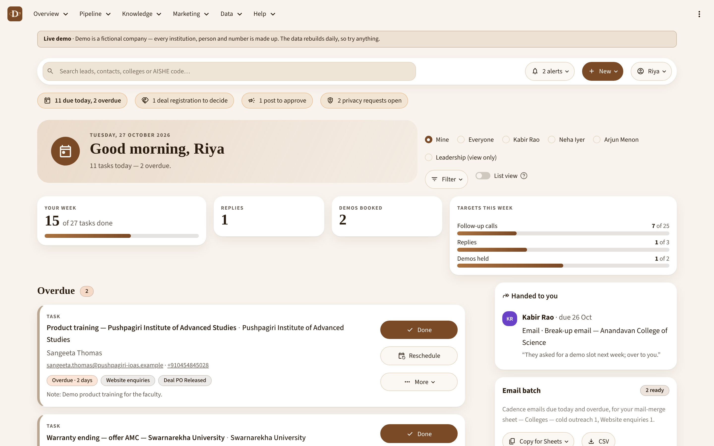
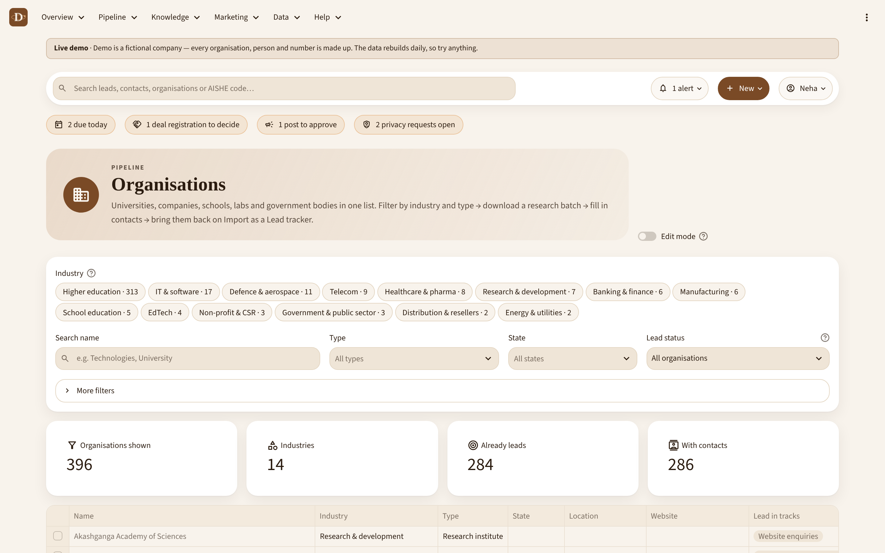
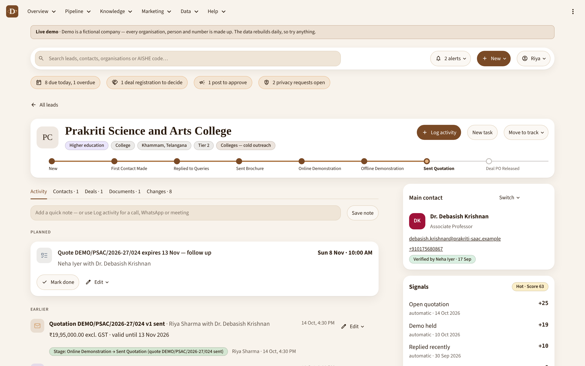
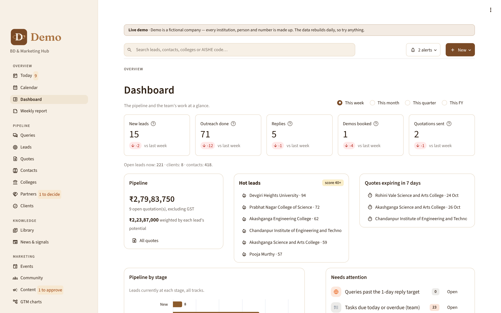
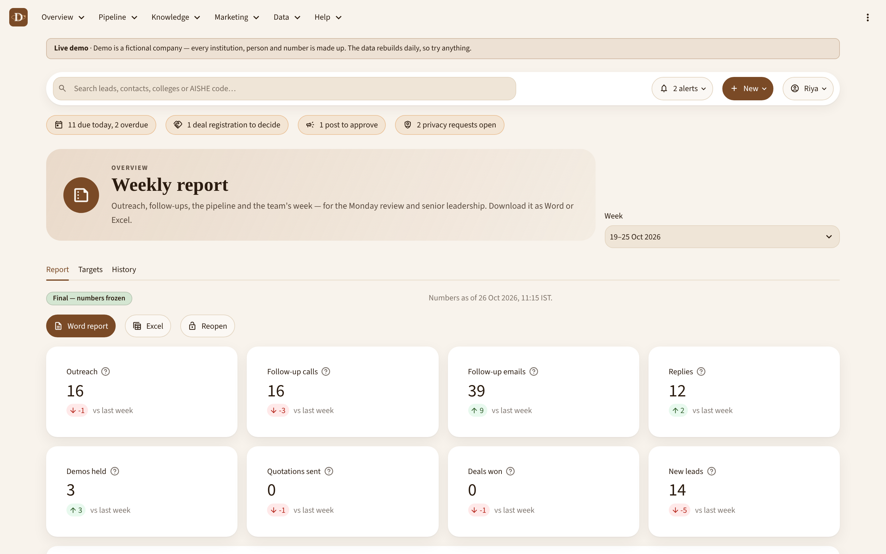
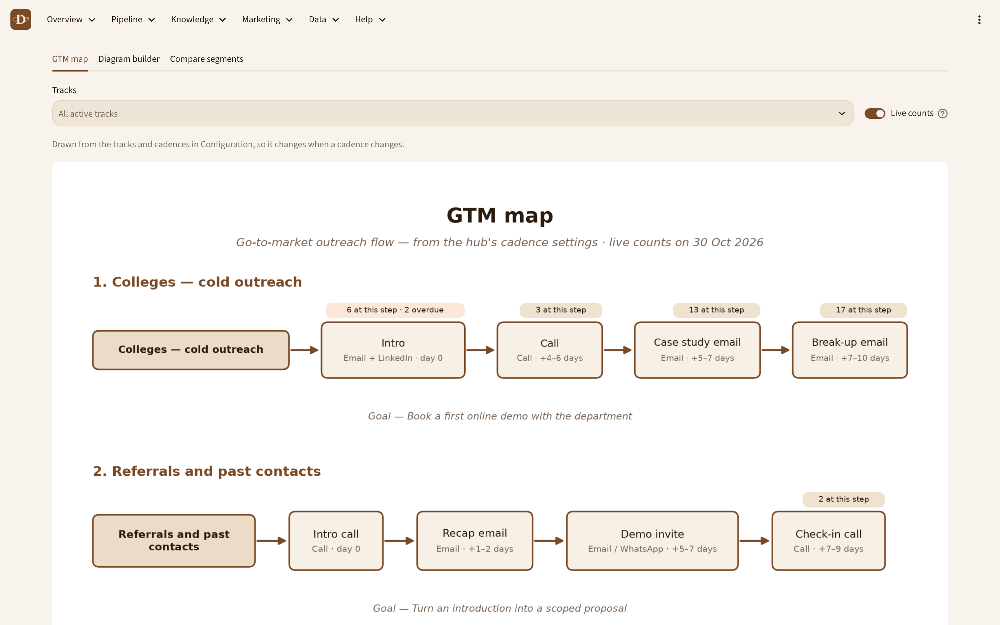
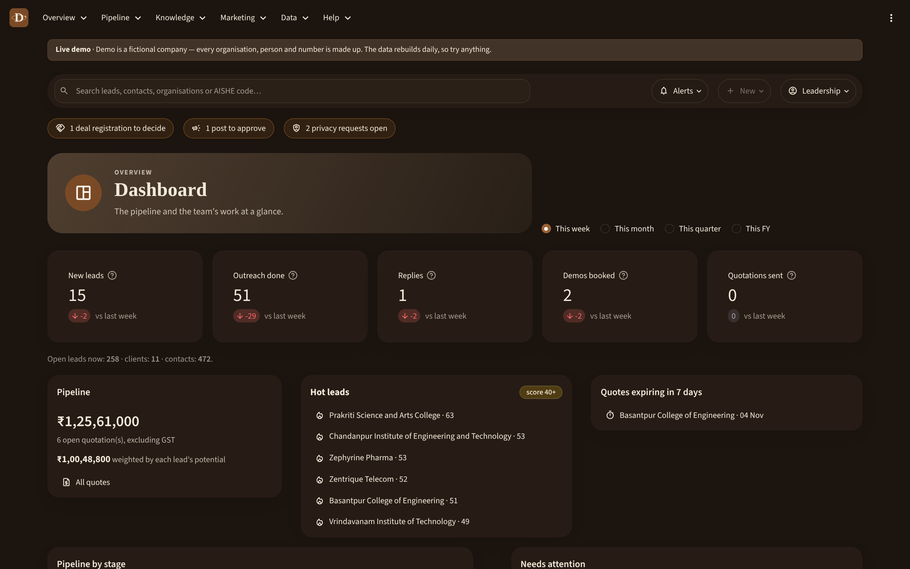
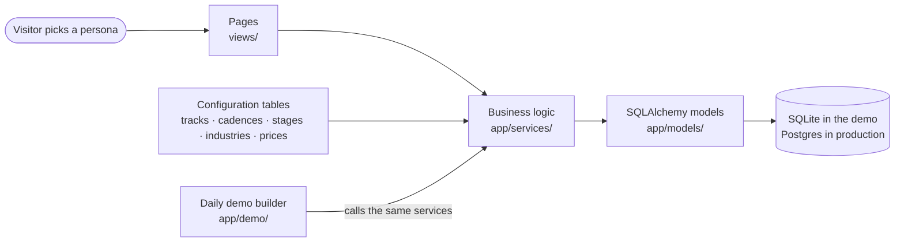

# BD & Marketing Hub

**One app for a small business-development team: leads, follow-ups, every conversation, quotes, partners,
marketing and the weekly leadership report, in one place instead of a dozen spreadsheets.**


[](https://github.com/MekhG/quantum-bd-hub-demo/actions/workflows/tests.yml)


I built this hub for the academia team of a deep-tech company that sells quantum teaching labs (simulators and
benchtop experimentation kits) to universities in India, and quantum upskilling to companies and public bodies.
This repository is the **public demo**: the code and every feature are real; the company (**Demo**), its team, the
organisations, contacts and prices are fictional, and the data rebuilds itself every day.



## The problem it solves

- Leads, follow-ups, scripts, brochures and reports lived in separate spreadsheets, inboxes and folders.
- Nobody could see *who to contact today* or *what was said last* across email, calls, WhatsApp and meetings.
- Follow-ups slipped because each one was remembered by hand.
- The weekly leadership report took hours to put together.

## What the hub does

| Area | What you can do |
|---|---|
| **Organisations & CRM** | Any organisation (universities, companies, schools, research labs, public bodies), filtered by **industry** and type. Contacts and leads across eight lead tracks. Safe spreadsheet imports with preview, duplicate matching and undo. Editable tables with an audit log. |
| **Outreach** | Cadences plan every follow-up for each track, and a reply stops them. **Today** shows each person's overdue and due work, hottest leads first. Calendar, mail-merge email batches, bounce handling. |
| **One timeline per lead** | Every call, email, WhatsApp, meeting and demo on the lead record, with next steps, hand-offs and stage history. |
| **Knowledge base** | Versioned document library with admin approval, call and email scripts with fill-in fields, an objection library. |
| **Sales** | Deals with procurement checklists per buying route, a price list and bundles, quotations generated as Word files. |
| **Partners & clients** | Reseller deal registration with an overlap check and a 60-day lock. Post-sale delivery, installation, warranty and AMC reminders. |
| **Marketing** | Events and a community database with consent rules, a LinkedIn/Instagram content calendar with approval and engagement tracking, GTM charts drawn from the cadence settings, segments compared by industry. |
| **Intelligence** | Live news feeds tagged by topic; signals (lab approved, tender, new centre, quantum team announced…) that score leads and reorder Today. |
| **Reporting** | Dashboard by Indian financial year; a weekly leadership report with targets that freezes when finalised and downloads as Word and Excel. |
| **Privacy (DPDP Act)** | Find every record for an email, export it, stop contact or delete everywhere, with a 30-day due date and a one-way hash that keeps deleted people out of later imports. |

## Try the demo

[Run it locally](#run-it-locally) (about a minute), then pick a persona on the welcome page and click anything; nothing you change survives the daily rebuild.

| Persona | Role | Try this |
|---|---|---|
| Riya | Admin | Open a hot lead, book a demo, then build a quotation as a Word file |
| Kabir | Member | Download today's email batch, mark it sent, and watch each cadence move on |
| Neha | Member | On **Organisations**, pick an industry, download a research batch, paste rows back on **Import** |
| Leadership | Viewer | Open **Weekly report** and download it on the letterhead |

A link like `…/?as=kabir` opens the demo straight into one persona.

## Screenshots

| | |
|---|---|
|  |  |
| **Organisations**: one list, filtered by industry and type | **Lead record**: stage bar, timeline, main contact, signals |
|  |  |
| **Dashboard** by financial year | **Weekly report** that writes itself |
|  |  |
| **GTM map** drawn from the configuration | Light and **dark** themes |

More in [`docs/screenshots`](docs/screenshots).

## How it's built



| Layer | Choice | Why |
|---|---|---|
| Interface | **Streamlit** (Python) with a custom theme and shared components, checked against WCAG 2.1 AA | Fast to build, one language for the whole app |
| Data | **SQLAlchemy 2** models, **Alembic** migrations, Postgres (Supabase) in production, SQLite here | The data model is the backbone and would survive a future React front end |
| Configuration as data | Tracks, cadences, stages, activity types, industries, products, prices and signal weights are rows in tables | The team changes its process without a developer |
| Documents | **python-docx**, **openpyxl**, **matplotlib** | Leadership gets Word and Excel files, not screenshots |
| Quality | **178 pytest checks** run on every push (GitHub Actions), including guards that the demo contains no real names, emails, phone numbers or business terms | Safe to publish |

### Engineering highlights

- **A demo world written by the app itself.** `app/demo/build.py` moves a clock day by day through twelve weeks
  while `app/demo/story.py` calls the hub's own services. Neha imports research batches, cadences run, the team
  works its tasks, organisations reply, demos and quotes happen, POs arrive and every Monday's report is
  finalised. Every timeline, score and report is exactly what the real app would produce. The run is seeded, so the
  same day always builds the same world.
- **Nobody waits for fresh data.** The database is rebuilt once a day on a background thread while visitors keep
  using yesterday's; a database built by older code is never served after a redeploy.
- **Caches that are never stale.** Pages cache their tables for up to an hour, and a counter that goes up on every
  commit that wrote rows clears them the moment anyone saves anything.
- **Imports that forgive messy sheets.** Header matching by alias, duplicate detection by AISHE code, web domain or
  name, industry and job-title wording mapped to the configured lists, a preview before anything is saved, and undo.
- **Privacy by design.** Every contact has a consent record; deletion leaves only a one-way hash, so the person is
  never imported again.

## Run it locally

```bash
python -m venv .venv
source .venv/bin/activate          # Windows: .venv\Scripts\activate
pip install -r requirements-dev.txt
streamlit run streamlit_app.py     # builds data/demo.db on first open (about 15–30 seconds)
pytest                             # all checks, including the demo guards
```

Build the data for any date: `python -m app.demo.build --today 2026-10-22`. To put it online, see
[DEPLOY.md](DEPLOY.md) (Streamlit Community Cloud, free, no secrets needed).

| Setting (env var or Streamlit secret) | Default | What it does |
|---|---|---|
| `DEMO_MODE` | `1` | Persona picker instead of sign-in. `0` gives the original Google sign-in. |
| `DATABASE_URL` | *(none: SQLite in `data/`)* | Use a throwaway Postgres instead; fill it with `python -m app.demo.build --url …` |
| `DEMO_AUTHOR`, `DEMO_AUTHOR_URL`, `DEMO_REPO_URL` | author name only | Credits and links on the welcome and About pages |

## Project layout

```
streamlit_app.py      Entry point: background data refresh, persona picker, top menu, then the chosen page
views/                The pages (Today, Organisations, Leads, Quotes, Weekly report, GTM charts, About…)
app/models/           Tables (SQLAlchemy)
app/services/         Business logic, kept separate from the screens
app/ui/               Shared layout and components
app/seed/             Starting configuration (Demo's tracks, cadences, industries, products, settings)
app/demo/             The demo: data builder, the twelve-week story, word pools, personas, daily refresh
assets/               Demo's logo and the quotation template
tools/                Scripts that drew the logo and the quotation template
alembic/              Database migrations (Postgres)
tests/                pytest checks (run on a throwaway database)
```

## About the data

Everything in the demo is invented: organisation names are made-up words, people's names are random combinations,
every email is on the reserved `.example` domain, and every phone number starts `+91 0…`, which no Indian mobile
uses. The News & signals page reads real public news about quantum technology.

## Author

**Mekhala Ganguly**, Quantum Program Lead (academia). This hub is one of the projects on my portfolio.

## License

[MIT](LICENSE) © 2026 Mekhala Ganguly. The libraries this app uses keep their own licences. Fonts are loaded from
Google Fonts (SIL Open Font License).
